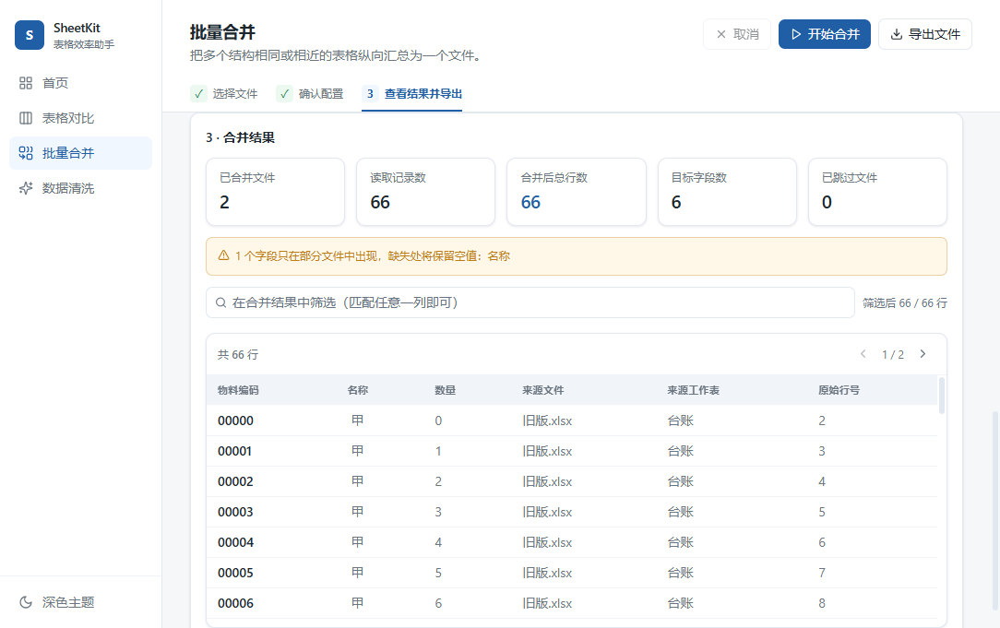

# SheetKit 表格效率助手

用于公司内部 Windows 办公的本地表格工具，支持表格对比、批量合并和数据清洗。支持 `.xlsx`、`.xlsm` 和 `.csv`，结果另存为新的 Excel 文件。

| 表格对比 | 批量合并 | 数据清洗 |
| --- | --- | --- |
|  |  |  |

## 快速开始

双击 `dist\SheetKit.exe`。也可以将这一个 EXE 单独拷到目标机器上运行。需要 Windows 10/11 和 Microsoft Edge WebView2 Runtime。启动时如果提示缺少 WebView2，请从微软官网下载 Evergreen Runtime。目标机器无需安装 Python、Node.js 或服务器。

三个功能都按 **选择文件 → 确认配置 → 查看结果并导出** 操作。可点击选择文件或拖放磁盘文件。选择工作表后，SheetKit 会检查前 16 行并尽可能推荐表头。请核对预览和原始行号，必要时修改「表头行」。高级选项可按需展开。

运行中可查看进度和取消。结果支持分页和跨列筛选。导出后可以打开结果或所在文件夹。文件或处理选项变更后，界面会提示重新运行，避免导出上一次的结果。

## 表格对比

1. 分别添加旧版和新版文件，核对各自的工作表和表头。
2. 确认用于匹配同一条记录的列，例如物料编码。可以手动勾选多列组合。系统优先检查两张表共有的编号类字段及有限的组合，验证空值、重复和能否匹配后给出理由。无法可靠验证时可手动选择。
3. 点击「开始对比」，按新增、删除、修改、异常、细微差异查看结果。修改明细含旧值、新值、比较方式及两侧原始行号。

同一匹配字段可以对应两张表中的不同行号。空字段和重复字段的记录进入异常区，其余可确定的记录继续比较。对侧重复导致无法判定时也进入异常区。

默认忽略文本首尾空格。高级选项支持忽略大小写、指定参与比较的列、选择按十进制数值比较的列并设置容差。数值解析失败会回退到文本比较并标记方式。仅在所选规则下被视为相同的表达差异进入「细微差异」。细微差异可以和同一记录其他列的实际修改同时出现。摘要分别显示按所选规则修改的记录数和已匹配记录中按严格内容比较有差异的数量。

报告包含摘要、新增、删除、修改明细和异常记录，有细微差异或缺失列时附对应工作表。可在运行前勾选「在结果和报告中保留按规则未变化的记录」。明细含冻结表头、自动筛选、列宽和颜色标记。

## 批量合并

1. 添加多个文件或一个文件夹，核对各文件的工作表、表头和参与状态。
2. 同名列自动对齐。「确认使用推荐」会应用明确的别名建议，例如将出货日期对齐到发货日期。存在歧义时可展开「手动调整列名与模板」检查并输入目标列名。
3. 查看目标列和缺失提示，运行合并。输出保留来源文件、工作表和原始行号。

字段按名称对应。缺失列留空，默认保留重复行。同一文件中的两列映射到同一列时，需先修正冲突。结果和报告列出文件数、读取和输出记录数、部分文件缺失的字段和跳过原因。

已确认且对各文件含义一致的列名对应关系可以命名保存。下次打开同类台账，在「手动调整列名与模板」中应用。源列缺失时会提示，修正表头或换用其他模板后可继续。

## 数据清洗

打开文件后，SheetKit 检查前 500 条记录并推荐可能需要的规则。可以应用推荐、逐项修改或恢复默认。默认删除完全空白行，并仅标记重复记录。其他规则包括清理指定文本列首尾空格、标记必填缺失、检查日期与数字。

选择删除重复项时，先看影响预览，再在确认窗口中明确确认。引擎会再次检查确认状态。结果中浅黄表示重复，浅红表示必填缺失或格式异常，标记列保留文字原因。

结果区的「设置导出列」可选择和排序业务列，并保存为命名模板。报告保留异常标记和原始行号。缺少模板依赖的列时会显示具体列名。报告包含清洗结果、重复数据、异常数据和清洗摘要，摘要记录执行的规则、删除的空白行和重复行数，以及缺失、日期与数字异常统计。

## 数据与本地配置

- 表格只在本机处理。程序通过 WebView2 加载单文件 HTML，运行时没有 HTTP 服务。数据和结果保存在本次会话内存中。
- 配置保存在 `%LOCALAPPDATA%\SheetKit\templates.json`，内容为命名后的列名映射和输出列顺序。
- CSV 保持文本读入，支持 BOM、UTF-8、GB18030、Big5 等编码。混合列保留原类型，带前导零的文本和超出 Excel 15 位精度的长整数受导出保护。Excel 已舍入的输入数字无法恢复。
- 公式使用上次保存的缓存值，缺少缓存时按空值处理并提示。宏文件以数据方式只读打开。旧版 `.xls`、`.xlsb` 和 WPS `.et` 请先在 Excel 或 WPS 中另存为 `.xlsx`。
- 导出保护输入文件路径，并使用同目录临时文件原子写入。公式样式的文本按字符串写入。导出被取消或失败时清理临时文件。
- 大报表的行底色应用于每张工作表的前 20,000 条记录。文字标记覆盖全部记录。

## 开发与验证

正式主线位于 `D:\exceltool`。前端使用 Vue 3、TypeScript、Tailwind CSS，Python 侧负责读取、处理、分页与导出，使用 openpyxl。Windows 外壳采用 pywebview 和 WebView2，PyInstaller 输出一个可执行文件。

```bat
python -m venv .venv
.venv\Scripts\pip install -r requirements-dev.txt
cd frontend
npm install
npm run typecheck
npm run build
cd ..
.venv\Scripts\python.exe python\main.py
```

```bat
.venv\Scripts\python.exe -m pytest
.venv\Scripts\python.exe -X utf8 tools\app_probe.py
.venv\Scripts\python.exe tools\benchmark.py
build.bat
```

`tools/app_probe.py --screenshots` 可在真实 Windows WebView2 窗口中复查主要流程并更新截图。独立 EXE 的原生对话框和导出测试使用 `tools/packaged_probe.py`，运行此测试前在开发虚拟环境中安装 `pywinauto`。这项依赖只用于验收。

[本轮验收记录](docs/verification.md)

## 许可证

项目代码版权归项目所有者。第三方组件遵循各自的许可证，包括 Vue、Tailwind CSS、Vite、pywebview、pythonnet、openpyxl、Lucide 和 PyInstaller。
